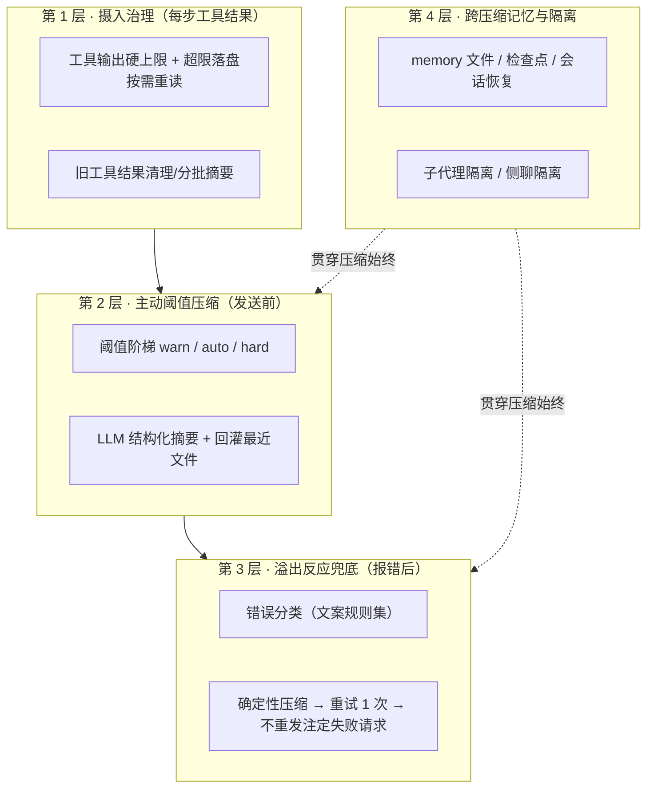

# AI 编程 Agent 上下文自动压缩机制调研——市面做法与 Zen 落地方案

> Generated 2026-10-12 · depth: deep · 47 sources · workspace: `research/zen-context-compaction/`

## Executive summary

- **成熟 agent 普遍采用"两层防线"：主动阈值压缩 + 溢出反应兜底**。Roo Code 明确为两层设计（阈值压缩 + 检测超限错误后自动削减 25% 重试）[1]；Cline 在 2026-08 的 PR 中把"错误分类 → 确定性压缩 → 重试一次"做成独立恢复路径 [2]。**Zen 目前只有第一层的一半，且完全没有第二层——这正是"溢出即报错停机"的直接原因**（内证见 §九）。
- **触发阈值没有统一答案，但设计模式收敛**：占比触发（Gemini 默认 0.5 [18]、Goose 0.8 [26]、Qwen 0.85 [21]）与绝对 token 窗口（Claude Code `autoCompactWindow`，1M 模型约 967K 触发 [4]）并存；Qwen Code 用 warn/auto/hard **三级阈值阶梯**并按窗口大小动态计算，小窗口提前触发 [21]。
- **自动压缩有前置条件：必须有可信的模型上下文上限**。Cline 明确修复为"未知模型不自动压缩，只保留手动压缩与 provider 确认的溢出恢复" [3]——对应 Zen 的 contextWindow=0 情况目前是"永不触发任何压缩"（内证）。
- **压缩 = 独立摘要请求**（同 system prompt + tools + 完整历史 + 末尾总结指令）[9][8]，摘要按固定 6 类结构化内容保留（请求与意图/关键概念/文件与代码片段/错误与修复/待办/当前工作），原样工具输出与中间推理不保留，压缩后**自动重读最近修改的 ≤5 个文件**回灌 [5]。
- **溢出兜底不能用 LLM 摘要器**：Cline 的教训是"摘要预算依赖刚出错的估算器，可能再次溢出"，恢复路径强制走**确定性压缩**（按预算裁剪）且每 run 只重试一次 [2]；错误识别靠文案规则集匹配（`context_length_exceeded` / `prompt is too long: N > M` 等），并显式否决 429 限流措辞防误判 [2]。
- **prompt cache 与压缩天然冲突**：缓存按累积前缀哈希命中，任何改写历史的压缩都会整条失效，压缩后第一轮等于全价 cache write [39]；因此 Anthropic 建议"每次清要清够"（`clear_at_least`）[10]，社区已有用户因压缩体验关掉 auto-compact [45]。
- **token 计数没有免费精确解**：Anthropic 官方 count_tokens 也自认是估算，且模型换 tokenizer 后同文本可漂移 +30%，官方建议"针对目标模型重新计数" [42]；实践共识是**本地估算 + 每轮真实 usage 校准 + 安全余量**三件套 [42][1]。
- **工具输出治理是性价比最高的一层**：Claude Code 对 bash 输出默认 30,000 字符硬上限、超限内容落盘由 Read 按需重读（后台任务输出已在 v2.1.277 改为此模式）[40]；Goose 把最老的工具请求/响应对分批摘要 [26]。
- **API 层正在原生接管压缩**：OpenAI Responses API 推出服务端 compaction（`compact_threshold`，产出加密不透明的 compaction item）[15]；Anthropic 提供 context editing（服务端清工具结果，官方自报 100 轮评测省 84% token）[11]。自研 agent 的客户端压缩在可见性和跨厂商兼容上仍有价值，但 API 原生路线值得 Zen 持续跟踪。

## Background & scope

Zen（Electron + Vue3 + better-sqlite3 的 AI 编程桌面端）已有 UI 层压缩（阈值触发、摘要注入），但长对话仍会出现**超出模型上下文 → API 报错 → agent 停止运行**。本调研回答：市面 AI 编程 agent（CLI / IDE / 桌面端）如何自动管理并压缩上下文、各自的触发阈值 / 压缩算法 / 摘要结构 / 工具输出治理 / 错误兜底是什么，并映射为 Zen 的落地建议。时间范围 2024–2026，优先最新一手来源；范围排除 RAG 知识库产品与消费级聊天产品。所有外部结论均来自 findings 文件（F1–F6）带引用的原始页面；Zen 现状部分为代码内证（file:line），单独标注。

## 一、机制全景：成熟 agent 的四层防线

把 17 个产品/框架的做法归纳起来，上下文管理是一个**分层漏斗**，不是单一开关：

- **第 1 层**在问题发生前瘦身：Claude Code 的 bash 30k 字符上限与落盘重读 [40]、tool-result clearing [6]；Goose 的工具对分批摘要（批次 10、永不触碰当前轮）[26]。
- **第 2 层**是主流方案：LLM 摘要 + 保留策略 + 回灌（§三）。
- **第 3 层**是停机问题的最后一道闸（§四）：Roo 削 25% 重试 [1]、Cline 确定性压缩重试 [2]、Claude Code 二次压缩保留更少 [6]、Goose 渐进移除工具响应 [26]。
- **第 4 层**决定"压缩后还记得什么"（§七）：memory tool [12]、Windsurf Memories [30]、Gemini checkpointing [20]、子代理隔离 [5][7]。

Anthropic 官方把这四类机制（compaction / tool-result clearing / memory / subagent 隔离）定位为**互补而非互斥** [8][12][5]。

## 二、触发机制：阈值设计与计数口径

**触发阈值光谱**（各家默认值差异极大，说明这是经济性权衡而非技术定数）：

| 方案 | 触发点 | 口径 | 来源 |
| --- | --- | --- | --- |
| Gemini CLI | 用掉 50% 窗口 | 占比 `model.compressionThreshold` | [18] |
| Goose | min(0.8, 225,000/窗口) | 占比 + 绝对上限（225k 刻意低于 OpenAI >272k 长上下文高价档） | [26] |
| Qwen Code | 三级阶梯 warn/auto/hard，上限 0.85 | 占比，按窗口动态计算，小窗口提前触发留摘要空间 | [21] |
| Roo Code | 滑杆默认 100%，但预留 30% 窗口（20% 输出 + 10% 缓冲） | 占比（有效值 ~70%） | [1] |
| Claude Code | 绝对窗口 `autoCompactWindow`（100K–1M 可配，1M 模型默认 ~967K ≈ 96.7%）；PCT override 只能调低 | 绝对 token 为主 | [4][40] |
| Codex CLI | `model_auto_compact_token_limit` | 口径可选 `total` 或 `body_after_prefix`（只对压缩前缀之后的增量计数） | [13] |
| VS Code/Copilot | "窗口填满时"自动压缩 | 未披露 | [27] |
| OpenHands | 事件数 > max_size | 条数（非 token） | [25] |
| Aider | 不主动触发，只报告 API 超限 | — | [24] |

三个值得 Zen 吸收的设计点：

1. **三级阶梯**（Qwen [21]）：warn 只提示、auto 触发压缩、hard 强制；比 Zen 现在的单级 80% 能给用户更早的预期管理（内证：`COMPRESS_THRESHOLD=80`，chat-compress.ts:25）。
2. **预留余量是标配**：Roo 预留 20% 输出 + 10% 缓冲 [1]；Aider 摘要预算显式减 512 tokens [23]；Codex 的 `body_after_prefix` 更进一步——压缩后保留固定前缀、只对增量计数，避免"压缩后立刻又触发" [13]。Zen 目前无任何预留，且固定 1800 token 开销低估真实 system prompt + 工具定义体积（内证：chat-types.ts:131）。
3. **未知窗口不自动压**：Cline 要求"已知或已配置的输入上限"才允许自动压缩 [3]。Zen 在 `contextWindow=0` 时 contextUsage 恒为 null、永不触发压缩（内证：chat.ts:278,285），等价于"未知模型完全裸奔"，应改为"禁自动压缩 + 保留溢出恢复"（见 §九）。

## 三、压缩执行：摘要请求、保留策略与回灌

**执行流程（Claude Code 为代表）**：压缩发起一个**独立摘要请求**——与主对话相同的 system prompt、tools 和完整历史，末尾追加一条总结指令作为最后一条 user 消息 [9][8]。缓存温热时该请求只付增量成本，但压缩必然使对话层缓存失效并从磁盘重载项目上下文；不需要连续性时 `/clear` 是零成本替代 [8][9]。

**摘要保留什么（官方结构化类别）**：用户请求与意图、关键技术概念、已查看/修改的文件及重要代码片段、错误及修复方式、待办任务、当前工作；**完整工具输出与中间推理不保留** [5]。Anthropic 工程博客的原则：摘要要保住**架构决策、未解决 bug 和实现细节**，丢弃冗余工具输出 [7]；压缩 prompt 的调优方法论是"先最大化召回，再迭代提精度"（避免过度压缩丢掉后续才发现关键的隐性上下文）[7]。

**压缩后的恢复/回灌**——这是各家一致投入的细节，比摘要本身更能决定续跑质量：

- Claude Code：自动**重读最近修改的 ≤5 个文件**（>5K tokens 的只留路径引用）、按每个 skill ≤5K/总计 ≤25K tokens 重注入已调用 skill 正文（最旧的先丢）、重跑 compact 来源的 SessionStart hooks [5]。
- Qwen Code：压缩后自动恢复最近触及的 **5 个文件**（小文件内嵌、大文件按路径引用）+ **3 张图片** [21]。
- Goose：把全部原始消息转为 `agent_invisible`（UI 仍可见、模型不可见）而非删除，插入结构化摘要（user_intent/files/pending_tasks/current_work 字段）+ 一条 assistant 续接指令，**原样保留最近一条纯文本用户消息** [26]。
- Aider：摘要以单条 user 消息回注并补一条 assistant "Ok."（保证消息序列合法）[23]。

**消息序列合法性是硬约束**：LangChain 文档明确警告——删消息后历史通常要以 user 开头、assistant 的 tool call 必须紧跟对应 tool 结果，任何截断实现都要遵守 [34]；Roo Code 甚至因此强制压缩使用当前会话同一模型（避免跨模型翻译破坏结构化内容）[1]。

**压缩用哪个模型——证据存在分歧，需自行决策**：
- Roo Code：**强制同模型**，理由是混合模型会破坏 tool call/结构化内容的翻译一致性 [1]。
- Qwen Code：支持独立 `compactionModel` 降本提速 [21]；Letta 默认按 provider 取小模型（claude-haiku-4-5 / gpt-5-mini / gemini-2.5-flash）[37]；Aider 用弱模型分块摘要 [23]。
- Claude Code：fallback 链明确**拒绝换到更小窗口的模型**做压缩（否则摘要点会截断对话）[41]。
- 折中判断 [speculative]：主动压缩（预算充足）可考虑小模型省钱；溢出兜底压缩（预算已失真）必须确定性执行、不依赖任何模型（见 §四）。

**手动压缩作为补充**：`/compact` 可带焦点指令（`/compact focus on the auth bug fix`）[8][27]；Cline 提供 `/newtask`（蒸馏开新任务）与 `/smol`（就地压缩）两条命令 [22]；OpenHands 把"强制压缩"做成一等 REST 端点 [47]。Zen 已有手动按钮（内证），可加焦点指令参数。

## 四、反应式兜底：溢出错误后的自动恢复（Zen 最大缺口）

即使有前两层，压缩仍可能失败或来不及（单条超大 prompt、估算失真、窗口未知）。市面的反应式设计：

- **Roo Code**：检测 provider 超限错误 → 自动削减 25% 上下文 → 重试（内置重试上限），与阈值压缩构成两层防线 [1]。
- **Cline PR #12804**（2026-08，最完整的公开蓝图）：在 provider 错误分类层识别 `context_window_exceeded`（**带 429/限流措辞否决**——"TPM-limit messages also say 'tokens exceeded'"）；恢复时**绕过 token 估算触发器、强制走确定性 "basic" 压缩**而非 LLM 摘要器（"摘要调用用同一个低估的估算器做预算，可能再次溢出"）；**每 run 只重试一次**；"单条超大首 prompt"直接失败且不重发注定失败的请求，把原始 provider 报错附在提示后（"prompt is too long: 213462 tokens > 200000 maximum"）；用户看到的是状态通知（"context window exceeded — compacting and retrying"）而非报错 [2]。
- **Claude Code**：压缩后请求仍超长 → **再压缩一次、保留更少的近期对话**（v2.1.141 起首次摘要按原始请求的溢出尺寸做种子）；依赖 API 报错文案可识别，"网关改写错误文案后该恢复不运行" [6][41][4]。
- **Goose**：主压缩摘要请求遭 ContextLengthExceeded 时，**渐进式移除工具响应**兜底 [26]。
- **反例 Aider**：从不主动执行 token 预算管理，只在 API 报错后报告并给出 `/tokens` `/drop` `/clear` 建议 [24]——对应"手动时代"的做法，已被主流抛弃。

**错误文案规则集**（Cline/Claude Code 暴露的变体，Zen 需自建）[2][41][44]：`context_length_exceeded`、`prompt is too long: N > M`、`exceeded max prompt tokens (N)`、`input length and max_tokens exceed context limit` 等；需排除 429/TPM 限流措辞；第三方网关可能改写文案，识别失败时只能退化为通用错误。

**社区失败模式清单**（避免重蹈）[44][45]：硬编码读取上限 + 无恢复导致用户弃任务重来；"Input too long" 重试死循环（上下文不缩小，重试必然同错）；本地计数与 provider 实际不符（189,413 > 163,840）导致"以为够用"；反复压缩后统计异常；压缩后丢上下文导致用户主动关闭 auto-compact。

## 五、计数与预算：token 计数的现实

- **官方计数也是估算**：Anthropic count_tokens 端点免费但明示"token count is an estimate"，且 Claude 4.7+ 换 tokenizer 后同文本约多 30% tokens，官方要求"针对目标模型重新计数" [42]。
- **实践共识 = 混合计数**：本地估算（快、防超发）+ 每轮真实 usage 校准（准、纠漂移）+ 安全余量（兜不确定性）[42]。Roo Code 的实现：优先厂商原生 count-tokens 端点，失败回退 tiktoken 估算，图片按 300 tokens/张保守估 [1]。
- **工具输出是预算大头**：Claude Code 对 bash 输出默认 30,000 字符硬上限（可调至 150,000）、后台任务输出落盘由 Read 按需读取（v2.1.277）、hook 输出超 10,000 字符自动存文件、skill 元数据按上下文窗口 1% 动态预算 [40]。
- **固定开销要按实测校准**：system prompt + 工具定义 + 注入指令的真实体积应从每轮 usage 反推，而非写死常量 [speculative，由 [42] 的校准原则推论]。

## 六、缓存经济性：压缩时机与 prompt cache 的冲突

- **机制根源**：prompt cache 按断点处的累积前缀哈希命中，"断点前任何 block 变化都会改变哈希"——把摘要替换进历史的压缩必然使整条会话缓存失效 [39]。
- **成本量化**：5 分钟 TTL 从请求开始计时（流式生成时间也计入），命中免费续期；cache write 5 分钟档 1.25×、1 小时档 2× 基准价，命中读取约 0.1×——**压缩后的第一轮请求等于全价 cache write** [39]。
- **Anthropic 的对策是"清要清够"**：context editing 提供 `clear_at_least` 参数，保证每次清理省出足够 token 让缓存失效"值得" [10][46]。
- **现实案例**：Claude Code 团队公开承认 1M 窗口 + 1 小时缓存下"离开电脑 1 小时后继续会话常是全量 cache miss"，官方因此在调查把默认上下文改为 400k [43]。
- **设计含义** [speculative，由上述证据推论]：压缩应**压力驱动而非定期/小幅**——一次压到位（对齐 clear_at_least 思想），避免"每轮压缩 5%"这类把缓存反复打穿的策略；压缩触发阈值要同时看 token 占比与"自上次缓存写入以来的时间"。

## 七、互补机制：让"不压缩也能撑更久"

- **memory / 持久记忆**：Anthropic memory tool（客户端文件操作，限 `/memories` 目录，系统指令要求"假设中断"随时记录进度）与压缩互补——"compaction 缩小活跃上下文，memory 保住必须跨摘要存活的信息" [12]；Windsurf Memories 按工作区自动生成/检索持久事实 [30]；Cursor Projects 用跨 agent 同步的共享上下文文件承载长程知识（2026-09-10）[33]；VS Code 的原则是把持久指令放 custom instructions（每请求重注入）而非对话历史——"跨请求/跨会话的指令不应依赖对话历史承载" [28]。
- **子代理隔离**：官方示例"子代理读 6,100 tokens 文件、只返回 420 tokens"；工程博客量级估计"每个子代理消耗数万 tokens，只返回约 1,000–2,000 token 摘要" [5][7]；Cursor side chat 用父线程做隐藏引用上下文、保留自己的转录 [32]。
- **服务端 compaction（API 演进方向）**：OpenAI Responses API `context_management: [{type:"compaction", compact_threshold}]` 服务端触发压缩、流式返回**加密不透明**的 compaction item，另有无状态 `/responses/compact` 端点（输出须原样传给下一次调用）[15]；`truncation:"auto"`（从头丢弃）仍是官方默认关闭、不推荐的兜底 [16]；`previous_response_id` 服务端持态**不省 token**——链上历史仍按 input 计费，压缩才是降本手段 [17]。Anthropic context editing 在服务端清工具结果、客户端保留全量历史 [10]，官方自报 100 轮评测中让原本因上下文耗尽而失败的任务跑完、token 省 84% [11]。
- **检查点与会话恢复**（压缩失败后的第二道恢复路）：Gemini CLI checkpointing 在修改文件前自动保存"影子 Git 快照 + 完整对话 + 工具调用"，`/restore` 可同时还原 [20]；Codex `resume`/`fork` + SQLite 运行时状态 [14]；Gemini 另有 `maxSessionTurns` 硬闸兜底 [19]。
- **框架参考实现**：LangChain `SummarizationMiddleware`（trigger tokens + keep messages）[34]；Vercel AI SDK `prepareStep` 在**步间**改写消息基线做压缩（官方示例 100k 触发 `pruneMessages`）[35]；LlamaIndex 新版 Memory 按比例 FIFO 弹出并 "waterfall" 进 memory blocks [36]；Letta 四种 compaction 模式，其中 `self_compact_*` 专为保住 prompt cache 前缀（摘要请求带上原 system prompt 和 tools，前缀与正常请求一致从而命中缓存）[37]；分层记忆配额参考：memory blocks <20 个、<50k 字符 [38]。

## 八、对比总表

| 产品/框架 | 触发 | 压缩执行 | 溢出兜底 | 压缩后恢复 | 备注 |
| --- | --- | --- | --- | --- | --- |
| Claude Code [4][5][6][40][41] | 绝对窗口（1M 模型 ~967K），PCT 只能调低 | 独立 LLM 摘要请求 | 二次压缩保留更少；错误文案匹配 | 重读 ≤5 文件、重注入 skill、重跑 hook | 工具输出 30k 上限 + 落盘 |
| Codex CLI [13][14] | `model_auto_compact_token_limit`（口径 total/body_after_prefix） | LLM，prompt 可覆盖 + Pre/PostCompact 钩子 | 未取到文档 | — | resume/fork/SQLite 状态 |
| Gemini CLI [18][19][20] | 占比 0.5 | LLM（文档未详） | maxSessionTurns 硬闸 | checkpoint `/restore` | 会话 30 天保留 |
| Qwen Code [21] | 三级阶梯 warn/auto/hard（ceiling 0.85） | LLM + 可选 compactionModel + 无 AI `/compress-fast` | 未取到文档 | 回灌 5 文件 + 3 图 | 截图数触发器 |
| VS Code/Copilot [27] | 窗口填满 | 自动摘要（可关 `summarizeAgentConversationHistory.enabled`） | 未披露 | — | 实时 token 仪表盘 |
| Windsurf [29][30] | 文档未见自动压缩 | @历史对话只注入摘要+checkpoint | — | Memories 自动记忆 | 规则按激活模式预算化 |
| Cursor [31][32][33] | 文档无自动压缩（用户 fork/new chat） | — | — | side chat 隔离、Projects 共享上下文 | 缺证，见 Open questions |
| Cline [2][3][22] | 文档：手动 `/smol`；自动阈值常量未取得 | LLM 摘要 | 分类 → 确定性压缩 → 重试 1 次 | — | 未知模型禁自动压缩 |
| Roo Code [1] | 滑杆（默认 100%，预留 30%） | LLM，强制同模型 | 检测超限 → 削减 25% → 重试 | — | 原生 count-tokens 优先 |
| Aider [23][24] | 不主动 | 弱模型分块摘要（预算 -512） | 无（只报告） | — | 固定 1024 摘要预算 |
| OpenHands [25][47] | 事件数 > max_size | LLMSummarizingCondenser（保留 keep_first） | — | 强制压缩 REST 端点 | 宣称每轮成本降 2x |
| Goose [26] | min(0.8, 225k/窗口) | 结构化摘要 + 可见性翻转（不删除） | 渐进移除工具响应 | 原样保留最近用户消息 | 工具对分批摘要（默认关） |
| Letta [37][38] | 窗口放不下 | 摘 30% 步进 10%，小模型 | — | self_compact 缓存友好模式 | 四层记忆配额 |
| LangChain [34] | trigger tokens（示例 4000） | SummarizationMiddleware | trim/delete | — | 强调消息配对合法 |
| Vercel AI SDK [35] | prepareStep 自定义（示例 100k） | pruneMessages 步间执行 | — | — | 官方定位：压缩时机由开发者决定 |
| OpenAI API [15][16][17] | 服务端 `compact_threshold` | 服务端 compaction（opaque item） | truncation:auto（不推荐） | canonical window 原样传递 | 持态不省 token |
| Anthropic API [10][46] | `clear_tool_uses` input_tokens trigger | 服务端清工具结果 | — | 占位文本替代 | clear_at_least 保缓存经济 |
| **Zen 现状**（内证） | 单级 80%；contextWindow=0 永不触发 | **本地模板摘要**（非 LLM） | **无** | **无** | 仅发送边界压缩，run 内不压 |

## 九、对 Zen 的落地方案映射

> 本节基于代码内证（file:line，来自只读代码摸底）+ 上述市场证据。内证不属外部来源编号。

### 9.1 现状诊断（内证）

**架构事实**：
- 两套消息状态：UI messages（估算/展示）与 agent-core `this.messages`（真实载荷）。压缩只在**发送边界**发生：`chat.ts:672-682` 把压缩后 history 传给 `zen.agent.run({history})` → `agent-runner.ts:253` → `AgentSession.start()`（agent-session.ts:445-462 把 user/assistant 存入 messages、system 轮抽为 historyInstructions）。单次 run 内两套状态一致；跨 run 的 run 内累积则只有 agent-core 知道。
- **run 内循环无治理**：每步结束后 `stream.responseMessages` 全量 push（agent-session.ts:871-875），循环上限 `MAX_RUN_STEPS=200`（agent-parts.ts:16），中途永不压缩、永不清理。
- **工具输出治理几乎为零**：仅终端输出有截断（流式 1MB 缓冲、最终 `truncateOutput` 8000 字符，agent-tools.ts:168-182,245-272）；**readFile 无任何截断**（agent-tools.ts:69-76 → packages/tools/fs/src/index.ts:62-73 全文返回），大文件整份进 messages 且每步重复发送。
- **错误处理无分类**：`agent.stream()` 抛错或流内 error part → `emit error` → `finishRun("error")`（agent-session.ts:778-788,816-829,859-869）；无 400/413/context_length_exceeded 分类、无重试、无压缩兜底；UI 侧 error → `status=error`（chat-events.ts:391-395），唯一恢复手段是手动「继续」`continueRun`（chat.ts:525-532）。
- **计数**：`estimateTokens`（CJK 0.75/字、其余 4 字符/token，chat-types.ts:137-151）+ 固定开销 1800（chat-types.ts:131）；`contextUsage = max(上次真实 inputTokens%, 本地估算%)`（chat.ts:277-301）；阈值 `COMPRESS_THRESHOLD=80`（chat-compress.ts:25）；无预留余量。`contextWindow` 来自 `effectiveModel.capabilities.contextWindow`（chat.ts:271-273，源头 provider_models/catalog_models 的 capabilities_json），为 0 时 contextUsage 恒 null、永不触发（chat.ts:278,285）。
- **压缩产物**：`compressHistory` 是**本地模板摘要**而非 LLM 摘要（chat-types.ts:194-252，保留尾部 6 轮 + 截断行摘要），摘要以 system 轮注入 history 首位。
- **无锁定约束**：`.coder/` 无 agent-core 锁定，agent-core 可改。

### 9.2 溢出根因 ↔ 市场机制对照

| Zen 溢出根因（内证） | 市场成熟机制 | 证据 |
| --- | --- | --- |
| (a) run 内多步累积工具输出（readFile 全文无截断） | 步间治理：AI SDK `prepareStep` [35]；tool-result clearing [6]；Goose 工具对分批治理 [26]；输出硬上限 + 落盘 [40] | §一、§五 |
| (b) contextWindow=0 时永不触发任何防线 | 未知模型禁**自动**压缩，但保留手动压缩 + provider 确认的溢出恢复 | Cline PR #14867 [3] |
| (c) 溢出报错即终止，重发仍超限 | 反应式兜底：错误分类 → 确定性压缩 → 重试 1 次 [1][2]；二次压缩保留更少 [6] | §四 |
| (d) 估算不含 run 内工具输出、固定开销低估、无预留 | 混合计数（本地估算 + usage 校准 + 余量）[42]；预留 20%+10% [1]；`body_after_prefix` 口径 [13] | §二、§五 |
| (e) 模板摘要丢失语义（非 LLM），压缩后无回灌 | LLM 结构化摘要 6 类内容 [5] + 回灌最近文件 [5][21] | §三 |

### 9.3 分阶段建议

**P0 — 止血（解决"报错停机"）**
1. **agent-core 增加超限错误分类器**：按 §四 的文案规则集匹配 `context_length_exceeded` / `prompt is too long: N > M` / `exceeded max prompt tokens` 等变体，显式否决 429/TPM 限流措辞 [2]；错误码/原文通过 IPC 上报 UI。
2. **命中即确定性压缩兜底**：不调 LLM（Cline 的教训：估算已失真，摘要预算不可信 [2]）——按 token 预算从最旧轮次裁剪、保持 tool call/result 配对与 user 开头 [34]、保留最近 N 轮与最新用户消息 [26]；**每 run 重试 1 次**；仍失败则展示原始 provider 报错并提示手动干预，不重发注定失败的请求 [2]。
3. **工具输出硬上限**：readFile 与通用工具结果设上限（参考 bash 30k 字符 [40]），超限内容落盘（会话临时目录），结果里只返回摘要 + 文件路径，模型需要时用 read 工具按需重读 [40]。

**P1 — 补齐主动压缩（体验与质量）**
4. **阈值阶梯 + 预留**：warn 60% / auto 80% / hard 90%（对齐 Qwen 思路 [21]）；有效窗口 = `contextWindow − max(预留输出, 模型 maxOutputTokens) − 安全缓冲`（对齐 Roo 20%+10% [1]）；压缩一次压到位（对齐 `clear_at_least` 思想 [10]）。
5. **主动压缩升级为 LLM 结构化摘要**：同 system + tools + history + 总结指令的独立请求 [9][8]，摘要按 6 类内容 [5]，压缩后回灌最近触及的 ≤5 个文件（小文件内嵌、大文件按路径引用）[5][21]；保留现有模板摘要作为"无预算/快速"路径（对齐 Qwen `/compress-fast` [21]）。
6. **contextWindow 未知的前置条件**：未知模型禁自动压缩、保留手动压缩 + P0 的溢出恢复 [3]；主进程把 contextWindow 与安全余量经 IPC 下发 agent-core，run 内也据此判断。
7. **估算纳入 run 内累积**：UI 侧继续用真实 usage 校准 [42]；agent-core 在步间用 usage 输入值 + 本地估算监控累积，逼近阈值时在步间触发压缩（对齐 AI SDK prepareStep 定位 [35]）——压缩 hook 的归属：**agent-core 主导（步间 + 错误兜底），UI store 保留阈值展示与手动触发**。

**P2 — 增强（缓存经济与长程记忆）**
8. **缓存经济决策点**：压缩执行模型选同会话模型还是小模型（证据冲突：Roo 强制同模型 [1] vs Qwen compactionModel [21] / Letta 小模型 [37]）——建议默认同会话模型保结构化内容正确性 [1]，把 compactionModel 作为高级配置；参考 Letta `self_compact_*` 让摘要请求前缀命中缓存 [37]。
9. **跨压缩记忆**：任务状态/关键决策落盘为会话级 memory 文件并在每次请求注入（对齐 memory tool 的"假设中断随时记录" [12]）；手动压缩支持焦点指令参数（`/compact focus on ...` [8][27]）；会话已落 SQLite，可补 Gemini 式检查点恢复 [20]。
10. **子代理隔离**：若后续做子代理/并行探索，遵循"独立上下文、只回传摘要"的隔离模式 [5][7]。

### 9.4 需要拍板的决策点

1. 主动压缩摘要用 LLM（质量高、有成本与延迟）还是保留模板摘要（快、丢语义）——市场主流是 LLM，模板仅作兜底。
2. 阈值数值与是否开放用户配置（Qwen/Roo/Claude Code 均可配，默认值各异）。
3. 溢出兜底重试次数（市场共识：1 次 [2]）与确定性压缩的保留策略（Roo 削 25% [1] vs Cline basic 压缩 [2]）。
4. P0 的工具输出上限数值（30k 字符是 Claude Code 对 bash 的默认值 [40]，readFile 可能需要不同上限）。

## Open questions

- Cursor 是否存在未文档化的自动摘要行为？公共文档只描述用户 fork/new chat [31]（[single source][medium]）。Cursor 论坛/工程帖未能检索（搜索引擎被 CAPTCHA 阻断）。
- Trae、Continue 的上下文管理文档不可达（客户端渲染/无文档页），未纳入对比 [3 个子代理独立确认]。
- Codex CLI 与 Gemini CLI 内置压缩提示词逐字文本与失败降级路径需读源码（openai/codex Rust core、gemini-cli chatCompressionService）。
- Anthropic context editing 是否有独立计费条目未找到明确定价，仅确认缓存失效带来的 cache write 成本 [10][46]。
- Cline/Roo 的自动压缩阈值常量（代码迁入 monorepo 后未定位到）；Gemini CLI 传闻的 0.7 阈值与现行 0.5 的沿革未核实。
- Anthropic 新增的服务端 compaction API（platform.claude.com/docs/en/build-with-claude/compaction）与 Claude Agent SDK 的 autoCompact 回调值得单独精读（F1 follow-ups 提出，本轮未展开）。

## Sources

[1] Roo Code – Intelligent Context Condensing — https://roocodeinc.github.io/Roo-Code/features/intelligent-context-condensing (updated 2026-05-15, accessed 2026-10-12)
[2] Cline PR #12804 "Classify context window exceeded errors and auto-recover" — https://github.com/cline/cline/pull/12804 (merged 2026-08-03, accessed 2026-10-12)
[3] Cline PR #14867 "Require known input limit for automatic compaction" — https://github.com/cline/cline/pull/14867 (2026-10-06, accessed 2026-10-12)
[4] Claude Code docs – Model configuration (auto-compact windows/thresholds) — https://code.claude.com/docs/en/model-config (accessed 2026-10-12)
[5] Claude Code docs – How Claude Code manages context (context-window) — https://code.claude.com/docs/en/context-window (accessed 2026-10-12)
[6] Claude Code CHANGELOG (v0.2.47/v0.2.98/v1.0.51/v2.1.x) — https://raw.githubusercontent.com/anthropics/claude-code/main/CHANGELOG.md (accessed 2026-10-12)
[7] Anthropic Engineering – Effective context engineering for AI agents — https://www.anthropic.com/engineering/effective-context-engineering-for-ai-agents (2025-09-29, accessed 2026-10-12)
[8] Claude Code docs – Costs (compaction request cost, cache rebuild) — https://code.claude.com/docs/en/costs (accessed 2026-10-12)
[9] Claude Code docs – Prompt caching — https://code.claude.com/docs/en/prompt-caching (accessed 2026-10-12)
[10] Anthropic docs – Context editing — https://platform.claude.com/docs/en/build-with-claude/context-editing (accessed 2026-10-12)
[11] Anthropic news – Introducing context management — https://www.anthropic.com/news/context-management (2025-09-29, accessed 2026-10-12)
[12] Anthropic docs – Memory tool — https://platform.claude.com/docs/en/agents-and-tools/tool-use/memory-tool (accessed 2026-10-12)
[13] Codex CLI – Config reference — https://developers.openai.com/codex/config-file/config-reference.md (accessed 2026-10-12)
[14] Codex CLI – Developer commands — https://developers.openai.com/codex/developer-commands.md (accessed 2026-10-12)
[15] OpenAI – Compaction guide (Responses API) — https://developers.openai.com/api/docs/guides/compaction.md (accessed 2026-10-12)
[16] OpenAI – Responses API create reference (truncation) — https://developers.openai.com/api/reference/resources/responses/methods/create.md (accessed 2026-10-12)
[17] OpenAI – Conversation state guide — https://developers.openai.com/api/docs/guides/conversation-state (accessed 2026-10-12)
[18] Gemini CLI – Settings reference — https://raw.githubusercontent.com/google-gemini/gemini-cli/main/docs/cli/settings.md (main branch, accessed 2026-10-12)
[19] Gemini CLI – Session management — https://raw.githubusercontent.com/google-gemini/gemini-cli/main/docs/cli/session-management.md (accessed 2026-10-12)
[20] Gemini CLI – Checkpointing — https://raw.githubusercontent.com/google-gemini/gemini-cli/main/docs/cli/checkpointing.md (accessed 2026-10-12)
[21] Qwen Code – Settings (auto-compaction redesign) — https://qwenlm.github.io/qwen-code-docs/en/users/configuration/settings/ (updated 2026-10-03, accessed 2026-10-12)
[22] Cline docs – Using commands (/smol, /newtask) — https://docs.cline.bot/core-workflows/using-commands.md (accessed 2026-10-12)
[23] Aider source – aider/history.py (ChatSummary) — https://raw.githubusercontent.com/Aider-AI/aider/main/aider/history.py (accessed 2026-10-12)
[24] Aider docs – Token limits — https://aider.chat/docs/troubleshooting/token-limits.html (accessed 2026-10-12)
[25] OpenHands SDK – Context condenser — https://docs.openhands.dev/sdk/guides/context-condenser (accessed 2026-10-12)
[26] Goose source – crates/goose/src/context_mgmt/mod.rs — https://raw.githubusercontent.com/aaif-goose/goose/main/crates/goose/src/context_mgmt/mod.rs (accessed 2026-10-12)
[27] VS Code docs – Manage agent sessions (auto compaction, /compact, telemetry) — https://code.visualstudio.com/docs/agents/run/sessions/manage-sessions (accessed 2026-10-12)
[28] VS Code docs – Context concepts — https://code.visualstudio.com/docs/agents/concepts/context (accessed 2026-10-12)
[29] Windsurf docs – Cascade — https://docs.windsurf.com/windsurf/cascade/cascade (accessed 2026-10-12)
[30] Windsurf docs – Memories & rules — https://docs.windsurf.com/windsurf/cascade/memories (accessed 2026-10-12)
[31] Cursor docs – Agent (checkpoint restore / fork) — https://cursor.com/help/ai-features/agent (accessed 2026-10-12)
[32] Cursor docs – Agent overview (side chats) — https://cursor.com/docs/agent/overview (accessed 2026-10-12)
[33] Cursor changelog – Projects — https://cursor.com/changelog/projects (2026-09-10, accessed 2026-10-12)
[34] LangChain docs – Short-term memory (trim/delete/summarize) — https://docs.langchain.com/oss/python/langchain/short-term-memory (accessed 2026-10-12)
[35] Vercel AI SDK docs – Agent loop control (prepareStep, pruneMessages) — https://ai-sdk.dev/docs/agents/loop-control (accessed 2026-10-12)
[36] LlamaIndex source – chat_memory_buffer.py / memory.py — https://github.com/run-llama/llama_index/blob/main/llama-index-core/llama_index/core/memory/chat_memory_buffer.py (accessed 2026-10-12)
[37] Letta docs – Compaction — https://docs.letta.com/v1-sdk/messages/compaction/ (accessed 2026-10-12)
[38] Letta docs – Context hierarchy — https://docs.letta.com/v1-sdk/memory/context-hierarchy/ (accessed 2026-10-12)
[39] Anthropic docs – Prompt caching — https://platform.claude.com/docs/en/build-with-claude/prompt-caching (accessed 2026-10-12)
[40] Claude Code docs – Environment variables (output caps, TASK_MAX_OUTPUT_LENGTH, PCT override) — https://code.claude.com/docs/en/env-vars (accessed 2026-10-12)
[41] Claude Code docs – Errors & model config (recovery, fallback refusal) — https://code.claude.com/docs/en/errors (accessed 2026-10-12)
[42] Anthropic docs – Token counting — https://platform.claude.com/docs/en/build-with-claude/token-counting (accessed 2026-10-12)
[43] Hacker News – "Pro Max 5x quota exhausted…" (Boris Cherny on cache misses / 400k experiment) — https://news.ycombinator.com/item?id=47740541 (2026-04-12, accessed 2026-10-12)
[44] Cline issue #5251 "Input too long retry loop" (related #4389 #6055 #12996 #12111) — https://github.com/cline/cline/issues/5251 (2025-07-30, accessed 2026-10-12)
[45] Hacker News – users disabling auto-compact — https://news.ycombinator.com/item?id=46598495 (2026-01-13, accessed 2026-10-12)
[46] Anthropic docs – Context editing (docs.anthropic.com mirror) — https://docs.anthropic.com/en/docs/build-with-claude/context-editing (accessed 2026-10-12)
[47] OpenHands llms.txt API index (condense-conversation endpoint) — https://docs.openhands.dev/llms.txt (accessed 2026-10-12)
